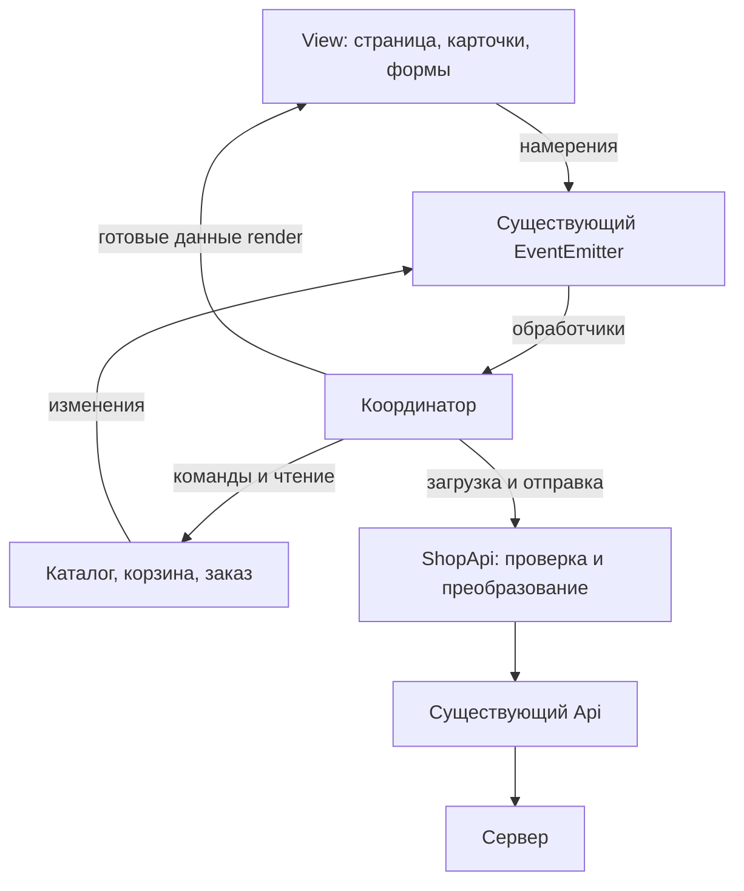
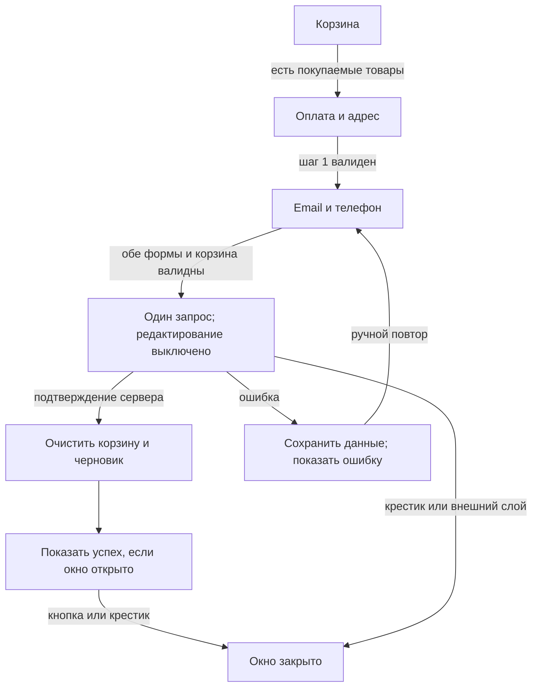

# WEB-ларёк — аудит и восстановление архитектуры

Проект №1, Яндекс Практикум, спринт 10 «Использование ООП». Этап 1, 14.11.2026.

**Текущий статус, этап 6:** реализован координатор createApp (AppPresenter по роли) и обычный запуск через src/index.ts. Production main.js содержит 95 463 байта кода приложения. Обычная production-страница загрузила 10 товаров с настоящего API в HTTP/DOM-проверке; успешные заказы проверены исключительно на контролируемом API. TypeScript, ESLint изменённых файлов, 42 + 85 тестов, 98 UI-регрессий, 37 сценариев координатора и 8 сценариев production-бандла проходят; последние UI-прогоны — DOM-эмуляция, не браузер/Windows. Этап 5 подтверждён на Windows пользователем. Этап 6 передаётся HEAD с открытым пунктом настоящего браузерного/Windows-прогона. Этап 7 не начат. Разделы 1–15 сохраняют историю, актуальная интеграция — в разделе 16 и STAGE6_REPORT.md.

Исходники прошлого спринта потеряны. Это новая обоснованная реконструкция по имеющемуся шаблону и текущему заданию; совпадение с потерянной архитектурой не утверждается. Другие учебные проекты не использованы.

## 1. Источники и границы достоверности

| Источник | Что установлено | Чего источник не подтверждает |
| --- | --- | --- |
| `MrGregGG/web-larek-project1-oop`, исходный коммит `9a7453a0cc60cc3945e9187278147bbe4a47d1a4` | Реальное дерево, код и конфигурации; до изменений рабочее дерево чистое, ветка `main` | Архитектуру потерянного спринта |
| Приложенный `web-larek-frontend-main(3).zip` | Все 142 файла побайтно совпадают с файлами исходного коммита репозитория | Наличие готовых моделей или магазина |
| Приложенный MHTML «1. Проект_WEB_ларёк_Использование_ООП_—_Яндекс_Практикум(3).mhtml» | Текст функциональных требований и последовательность разработки | JSON-схемы WEB-ларька, рабочий адрес API; отдельный чек-лист следующего урока |
| [Официальный шаблон Практикума](https://github.com/yandex-praktikum/web-larek-frontend) | Назначение шаблона и стек HTML, SCSS, TS, Webpack | Действующий сервер и формат ответа заказа |
| `api.yml` | Явно описывает Film/Afisha, фильмы, сеансы и билеты | **Не является спецификацией WEB-ларька** |

Далее «факт» означает проверенный исходник, «требование» — текст задания, «решение» — выбранный проектный подход, «проверить» — открытый вопрос. Чужие студенческие реализации не используются как источник контракта API.

## 2. Факты: карта существующей архитектуры

### 2.1. Сборка и окружение

| Файл/зона | Фактическое состояние и ограничения |
| --- | --- |
| `package.json` | Проект `my-webpack-project@1.0.0`; только `devDependencies`, React и библиотек состояния нет. Команды `build`, `build:dev`, `build:prod`, `watch`, `start`, `lint`, `lint:fix`, `format`, `deploy` существуют. Отдельных тестов нет |
| `package-lock.json`, `yarn.lock`, `.yarnrc.yml` | Есть два lock-файла; для этого аудита выбран npm. Смена менеджера не нужна. `npm ci` на текущем окружении обнаружил дефект lock-файла, см. раздел проверки |
| `tsconfig.json` | `target: es2017`, `module: es6`, `moduleResolution: node`, `noImplicitAny: true`, `allowJs`, `allowSyntheticDefaultImports`, `experimentalDecorators`; включены `src/**/*.ts` и `src/types/*.d.ts`. `strict` и `strictNullChecks` не включены |
| `webpack.config.js` | Вход `src/index.ts`; `ts-loader` и `babel-loader`; HTML через HtmlWebpackPlugin; SCSS через Sass/PostCSS/resolve-url/css/extract; изображения и шрифты — asset modules; source maps; Terser сохраняет имена классов/функций. Выход `dist`, dev-server `localhost`, hot reload. Конфигурация не изменена |
| `.babelrc` | `@babel/preset-env` и `@babel/syntax-dynamic-import`; последний разрешается Babel в `@babel/plugin-syntax-dynamic-import`, но пакет не объявлен в `package.json` |
| `postcss.config.js` | Autoprefixer |
| `.eslintrc.js`, `.eslintignore` | ESLint recommended, TypeScript recommended, Prettier; lint проверяет JS/TS в `src`. Исходные `Function` уже нарушают правила |
| `.prettierrc.json` | Табуляция, ширина 80, одинарные кавычки, точки с запятой, LF |
| `.env.example` | Только `API_ORIGIN=http://localhost:8080`; это пример локального origin, а не доказательство наличия backend |
| `.gitignore` | Исключены `node_modules`, `dist`, `.env`, IDE-папки, логи. `.env.production` отдельным шаблоном не исключён; не коммитить реальные настройки без проверки |
| `README.md` | Краткое описание стека/файлов и команд запуска. Архитектуры и предметных контрактов нет; в рамках этапа README не меняется |

Webpack загружает `.env.<NODE_ENV>`, если `NODE_ENV` задан, иначе `.env`. Следовательно, `npm run build` ищет `.env.production`, обычный запуск без `NODE_ENV` — `.env`. `API_ORIGIN` подставляется при сборке; пустой origin даёт относительные `/api/weblarek` и `/content/weblarek`. Proxy для backend в dev-server не настроен. Статика из `src/public` не копируется отдельным плагином: доставку favicon/manifest при публикации надо проверить отдельно.

Версии в lock-файле: TypeScript 5.0.4, Webpack 5.81.0, ESLint 8.39.0, Sass 1.62.1, ts-loader 9.4.2, webpack-dev-server 4.13.3. В `package.json` диапазоны с `^`; установка без lock-файла может выбрать более новые версии в этих диапазонах.

### 2.2. Уже реализованный код

| Элемент | Существующий API | Как переиспользовать / ограничение |
| --- | --- | --- |
| `Api`, `base/api.ts` | `constructor(baseUrl, options?)`, `get(uri): Promise<object>`, `post(uri, data, method?): Promise<object>`, защищённый `handleResponse` | Единственный HTTP-клиент. GET и JSON POST/PUT/DELETE. При не-2xx разбирает JSON и отклоняет Promise полем `error` либо `statusText`; не-JSON ошибка может стать ошибкой разбора |
| `ApiListResponse<Type>` | `{ total: number; items: Type[] }` | Переиспользуем generic в нормализованном списке; сама декларация не доказывает форму ответа конкретного сервера |
| `ApiPostMethods` | `'POST' \| 'PUT' \| 'DELETE'` | Второй такой тип не создаём; обычный заказ предполагает POST, endpoint ещё надо подтвердить |
| `EventEmitter`, `base/events.ts` | `on`, `off`, `emit`, `onAll`, `offAll`, `trigger`; имена `string \| RegExp`, wildcard `*` | Одна существующая шина. `emit` синхронный; произвольное имя не связано с типом данных. `trigger` объединяет payload и context, причём context имеет приоритет |
| `IEvents`, там же | `on<T extends object>`, `emit<T extends object>`, `trigger<T extends object>` | Используем существующий интерфейс; в нём нет `off`, хотя в классе метод есть. Для снятия подписок координатор хранит конкретный `EventEmitter` |
| `src/index.ts` | Только `import './scss/styles.scss'` | Будущая точка сборки зависимостей и первоначальной загрузки |
| `src/types/index.ts` | В исходном коммите пуст, 0 байт | Сюда добавлены контракты реконструкции; других предметных интерфейсов нет |
| `constants.ts` | `API_URL = API_ORIGIN + '/api/weblarek'`, `CDN_URL = API_ORIGIN + '/content/weblarek'`, `settings = {}` | Константы сохраняются. Пустой `settings` ничего не настраивает |

`Api` не проверяет JSON во время выполнения. Его `options` фактически сохраняет только объединённые headers: остальные поля `RequestInit` из конструктора не переносятся. Нет AbortSignal/idempotency/retry-механизма. Переписывать его на этом этапе не требуется; учитывать ограничения при интеграции.

### 2.3. Утилиты

| Функция/тип из `utils.ts` | Назначение и решение |
| --- | --- |
| `ensureElement`, `ensureAllElements`, `SelectorElement`, `SelectorCollection` | Поиск DOM с проверкой наличия; использовать с контекстом конкретного компонента, особенно для повторяющихся `.card__button` |
| `cloneTemplate<T>` | Клонирование первого элемента `<template>`; использовать для семи существующих шаблонов. Предполагает непустой корректный template |
| `bem`, `pascalToKebab` | Работа с БЭМ-именами; можно использовать без копирования. В regexp `pascalToKebab` стоит символ «–» в диапазоне `0–9`, не обычный дефис; не полагаться на преобразование цифр без отдельной проверки |
| `createElement` | Небольшая DOM-фабрика; нужна для пустой корзины/сообщения об ошибке, если выбран этот способ отображения |
| `setElementData`, `getElementData` | Преобразование dataset. Не использовать dataset как единственный источник типизированного товара; требуется явная проверка строк |
| `getObjectProperties` | Перечисляет свойства прототипа; автоматическая магия рендера через reflection не нужна |
| `isSelector`, `isEmpty`, `isPlainObject`, `isBoolean` | Общие проверки; `isEmpty` не проверяет пустые строки. `isPlainObject` вызывает `Object.getPrototypeOf` без защиты от null/undefined; не передавать туда такие значения |

В исходных утилитах есть `any`, `Function` и подавление TS через `@ts-expect-error`. Новые контракты их не повторяют. На этом этапе исходные утилиты не исправляются.

### 2.4. HTML и стили

| DOM/шаблон | Готовая разметка | Будущий владелец |
| --- | --- | --- |
| `.page__wrapper`, `.gallery`, `.header__basket`, `.header__basket-counter` | Контейнер каталога, корзина и счётчик | `Page` |
| `#modal-container` | Контейнер, крестик `.modal__close`, `.modal__content` | Единственный рабочий `Modal` |
| `#card-catalog` | Кнопка-карточка, категория, название, изображение, цена | `CatalogCard` |
| `#card-preview` | Полная карточка плюс `.card__text`, `.card__button` | `ProductPreview` |
| `#card-basket` | `li`, номер, название, цена и удаление | `BasketItem` |
| `#basket` | Список, `.basket__price`, `.basket__button` | `Basket` |
| `#order` | Кнопки `name=card/cash`, `input[name=address]`, submit и `.form__errors` | `OrderForm` |
| `#contacts` | `input[name=email/phone]`, submit и `.form__errors` | `ContactsForm` |
| `#success` | `.order-success__description`, `.order-success__close` | `Success` |

Кроме `#modal-container` в body находятся **ещё пять демонстрационных модальных блоков**. Один имеет `modal_active`, поэтому статический пример товара открыт сразу. Это демонстрация вёрстки, не работающий сценарий. На этапе UI их нужно убрать из рабочего DOM или изолировать; сейчас HTML не меняется. Нельзя выбирать рабочее окно через первый произвольный `.modal` или инициализировать компоненты из этих примеров. В демо есть следы Film (`alt`, классы успеха), но правильный `#success` уже существует.

`src/scss/styles.scss` подключает vendor, общие переменные/миксины и 10 БЭМ-блоков `common.blocks`. Готовы классы `modal_active`, `page__wrapper_locked`, `button_alt-active`, disabled-стили. Для категорий есть модификаторы `soft`, `hard`, `other`, `additional`, `button`. HTML подтверждает подписи только «софт-скил» и «другое»; остальных подписей API стили не доказывают. На неизвестную категорию выбираем `other`, текст оставляем исходный.

## 3. Требования Практикума и критерии приёмки будущей реализации

| Процесс | Проверяемое поведение |
| --- | --- |
| Главная | Каталог загружается с сервера; клик открывает подробности; иконка открывает корзину |
| Товар | Все сведения видны; один товар не появляется дважды. Вариант задания выбран: после добавления кнопка блокируется и сообщает «Уже в корзине». При `price === null` кнопка всегда выключена |
| Корзина | Список, удаление, пересчёт суммы и количества, оформление. Пустая корзина не позволяет перейти дальше |
| Шаг 1 | Оплата выбрана, адрес после `trim()` непустой; иначе текст ошибки и выключенная «Далее». Дополнительных ограничений адреса нет |
| Шаг 2 | При первом открытии в новом заказе email/phone пустые, «Оплатить» выключена. Достаточно непустых после `trim()` полей; регулярные выражения email/телефона не требуются |
| Сервер | Успех показывается только после подтверждения. Очистка корзины и всех полей происходит после подтверждения, независимо от того, закрыто ли окно успеха |
| Ошибка отправки | По заданию пользователя сохраняем корзину и черновик, показываем ошибку, разрешаем ручной повтор. Автоматического повторного POST нет |
| Успех | Кнопка «За новыми покупками!» только закрывает окно; никаких очисток на этой кнопке |
| Modal | Крестик и клик по внешнему слою закрывают окно; клик внутри не закрывает |
| Архитектура | Модель и View не имеют ссылок друг на друга. Повторный render не добавляет обработчики |

В тексте урока требуется следовать ранее объявленным типам. Здесь прежние типы недоступны, поэтому исходная точка восстановления явно зафиксирована этим документом и новым `types/index.ts`. Управление навигацией отдельной сложной сущностью в уроке необязательно: достаточно состояния и обработчиков координатора.

## 4. Решение: разделение ответственности

Упрощённый MVP: модели владеют данными и правилами, View — DOM, координатор — сценарием и преобразованием данных между ними. HTTP остаётся в существующем `Api`. Небольшой `ShopApi` — будущий предметный адаптер, который **содержит** один `Api`, проверяет ответы и преобразует их; он не реализует второй fetch-клиент.

Стрелка от координатора к View допустима. Прямых стрелок Model → View и View → Model нет. События передают снимки данных/идентификаторы, а не экземпляры моделей. DOM не помещается в модели.

### 4.1. Существующие и недостающие компоненты

| Элемент | Сейчас | Ответственность и решение |
| --- | --- | --- |
| `Api`, `EventEmitter`, DOM-утилиты | Есть | Переиспользовать без дублирования |
| `Component<T>` | Нет | Небольшой абстрактный UI-класс оправдан общими DOM-операциями и `render`; без шины/моделей/бизнес-правил по умолчанию |
| `CatalogModel` | Нет | Хранить товары, искать по id; не знать DOM/HTTP |
| `BasketModel` | Нет | Уникальные товары, запрет беспрайсовых, сумма и количество |
| `OrderModel` | Нет | Черновик, обязательные поля, ошибки, создание валидного снимка заказа |
| `ShopApi` | Нет | Порт `IShopApi`, валидация неизвестного JSON, существующий Api внутри |
| `Page` | Есть только DOM | Каталог DOM-узлов, счётчик, блокировка страницы, статус загрузки/ошибки |
| `CatalogCard`, `ProductPreview`, `BasketItem` | Есть только templates | Три разных отображения товара, каждое получает подготовленные данные |
| `Basket` | Есть только template | DOM-список, итог, доступность оформления; сама сумму не считает |
| `Modal` | Есть только DOM | Содержимое, открыть/закрыть, крестик/внешний слой; не управляет покупкой |
| `Form<T>` | Нет | Общий submit/input и отображение ошибок/disabled; без проверки бизнес-полей |
| `OrderForm`, `ContactsForm` | Есть только templates | Способ оплаты/адрес и контакты соответственно |
| `Success` | Есть только template | Потраченная сумма и событие закрытия |
| Координатор `createApp` | Нет | Связать зависимости, события, состояние экрана, загрузку и отправку |

Не нужны отдельный валидатор-класс для четырёх полей, абстрактная базовая модель для трёх небольших моделей, Singleton, роутер, глобальное хранилище-фреймворк, универсальная карточка с набором необязательных DOM-полей. Общие небольшие функции форматирования можно выделить при реализации без новых иерархий.

### 4.2. Модели: данные и методы

| Класс | Данные | Методы и смысл |
| --- | --- | --- |
| `CatalogModel` | Приватный список снимков товаров | `setItems(items)` проверяет уникальность id, заменяет список и публикует `catalog:changed`; `getById(id)` возвращает снимок либо undefined; `items` только для чтения |
| `BasketModel` | Приватный Map по id с копиями покупаемых товаров | `has(id)`; `add(product)` проверяет конечную неотрицательную цену, не допускает null/дубль, возвращает boolean; `remove(id)` возвращает, было ли изменение; `clear()`; `getState()` возвращает снимок `{items,count,total}` |
| `OrderModel` | `payment: null`, пустые address/email/phone | `setField(field,value)` меняет поле и публикует черновик/валидацию; `validate()` отдельно проверяет два шага; `createOrder(basket)` создаёт новый объект с копией id и пересчитанной суммой, проверяет обе формы/непустую корзину; `clear()` сбрасывает все поля |

Конструкторы моделей принимают существующий `IEvents`, без View/Api. Сумма и count вычисляются из выбранных товаров, не хранятся как независимые изменяемые поля. Снимки копируют массивы и объекты: TypeScript `readonly` сам по себе не обеспечивает неизменяемость во время выполнения. `items` не содержит количества: количество одной позиции всегда 1, count — число уникальных id.

`price === 0` — допустимая цена; проверять через истинность нельзя. Отрицательные, NaN и бесконечные значения отклоняются при нормализации/добавлении. Отсутствующий товар при событии с id не добавляется. Повторное добавление/удаление отсутствующего id не генерирует ложное изменение. При отправке корзину нельзя менять через координатор; это защищает снимок покупки от потери данных при последующей очистке.

### 4.3. View: методы и жизненный цикл

Конструктор каждой View принимает её HTMLElement; интерактивные View дополнительно получают существующий `IEvents`. Ни одна не получает модель, `IShopApi` или координатор. Конструктор один раз находит дочерние элементы, создаёт сохранённые функции-обработчики и подписывает DOM. `render(data)` обновляет элементы, значения, классы и disabled; подписок внутри него нет.

| View | Основные методы / параметры render |
| --- | --- |
| `Component<T>` | Защищённый container; `render(data: T): HTMLElement`; небольшие помощники `setText`, `setDisabled`, `setImage`, `toggleClass`, если реально повторяются. Без reflection/Object.assign произвольных полей |
| `Page` | `render(PageViewData)` заменяет детей галереи, счётчик и класс locked; клик корзины публикует `basket:open` |
| `CatalogCard` | `render(CatalogCardData)` обновляет текущий id и карточку; клик публикует id из текущего состояния View, а не захваченное старое значение |
| `ProductPreview` | `render(PreviewData)` плюс описание, текст/disabled кнопки; событие `basket:add` |
| `BasketItem` | `render(BasketItemData)` номер с 1, название, цена, disabled удаления; `basket:remove` |
| `Basket` | `render(BasketViewData)` заменяет список, сумму, disabled; `checkout:start` |
| `Modal` | `render({content: HTMLElement})`, `open()`, `close()`; замена содержимого не считается закрытием; жизненный цикл публикуется лишь при фактической смене открыто/закрыто |
| `Form<T>` | `render(FormViewState<T>)`, submit с preventDefault, input с проверкой имени поля; ошибки в `.form__errors`; событие изменения — конкретное у наследника |
| `OrderForm` | `render(OrderFormData)`; кнопки оплаты отражают `payment`, переключают `button_alt-active`; `order:change`, `order:next` |
| `ContactsForm` | `render(ContactsFormData)`; `contacts:change`, `order:submit`; сообщение сервера рядом с ошибками |
| `Success` | `render(IOrderResult)` выводит total; кнопка публикует `success:close` |

При реализации предусмотреть `destroy(): void` для View с DOM-подписками и снятие конкретных обработчиков. При замене списка старые View освобождаются либо повторно используются по id; не создавать глобальную подписку шины на каждую карточку. Отписки координатора делают через существующий `EventEmitter.off`, сохраняя исходные callback. `offAll()` не применять при обычном render/смене окна.

Для overlay проверять `event.target === container`; клик по `.modal__container` не закрывает окно. Использовать `#modal-container`. Page получает locked из координатора по `modal:opened/closed`; разблокировать и при закрытии во время ожидания сервера. Escape/focus management — возможное улучшение следующего этапа, а не заявленная готовая функция.

## 5. Решение: состояния и оформление заказа

Координатор — обычная функция `createApp` в `src/app.ts`, не новая универсальная инфраструктура. В `src/index.ts` остаются импорт стилей и вызов сборки приложения. Координатор хранит `ScreenState` и независимый `SubmissionState`, подписывается один раз, вызывает модели и готовит render-данные. Выбранный товар хранится как productId в состоянии экрана; второй изменяемый product-объект не нужен.

Закрытие окна не отменяет запрос: ветвь подтверждения/ошибки продолжает выполняться даже после перехода в closed. На диаграмме очистка и обработка запроса не зависят от ветви закрытия.

| Текущее состояние | Условие / событие | Следующее действие |
| --- | --- | --- |
| closed / basket | `product:open`, id есть | product, подготовить подробности и состояние кнопки |
| product | `basket:add`, товар покупаемый, запроса нет | добавить; обновить счётчик и карточку; оставить окно открытым |
| любое, кроме pending-редактирования | `basket:open` | basket; пустой список допустим, оформление выключено |
| basket | `checkout:start`, count > 0, не pending | order; отобразить существующий черновик |
| order | `order:next`, шаг 1 валиден | contacts; при первом оформлении контакты пустые |
| contacts | `order:submit`, обе формы и корзина валидны, не pending | Синхронно поставить pending до первого await, создать отдельный снимок заказа, выключить редактирование, отправить |
| pending | повторный submit/add/remove/change/start | Игнорировать в координаторе; UI также disabled. Одного disabled недостаточно |
| pending | сервер подтвердил покупку | Сначала сохранить result, затем clear корзины/черновика, обновить View; если окно закрыто — не открывать его неожиданно |
| pending | запрос/проверка ответа завершились ошибкой | Не очищать данные, снять pending, показать ошибку; если закрыто — сохранить её для повторного открытия |
| любое открытое | крестик/overlay | closed; данные не очищать; запрос не отменять |
| success | `success:close` | Только close; модели уже очищены |

Повторное открытие после ошибки/закрытия — продолжение того же незавершённого заказа: черновик сохраняется. Нельзя очищать контакты на каждом render или открытии окна. Требование о пустых полях выполняется при первом открытии нового заказа и после подтверждённой покупки; иначе оно противоречило бы сохранению данных при ошибке. Если проверяющий требует иной политики повторного открытия, согласовать её отдельно.

Ошибка формата ответа после фактического принятия заказа сервером неоднозначна. До проверки протокола нельзя обещать безопасный повтор без дубля. Не добавлять выдуманный idempotency key: проверить поддержку сервером. Автоматический retry запрещён проектным решением; пользователю показывается понятная ошибка.

## 6. Решение: таблица событий существующего EventEmitter

Полная карта данных находится в `AppEventMap`. Ниже все 16 событий; пустой payload — `{}` (`Record<string, never>`), передаётся явно.

| Имя | Издатель | Данные | Подписчик / действие |
| --- | --- | --- | --- |
| `product:open` | CatalogCard | `{ id }` | Координатор читает каталог, открывает preview |
| `basket:open` | Page | `{}` | Координатор отображает корзину |
| `basket:add` | ProductPreview | `{ id }` | Координатор проверяет pending, передаёт товар BasketModel |
| `basket:remove` | BasketItem | `{ id }` | Координатор удаляет при отсутствии pending |
| `checkout:start` | Basket | `{}` | Координатор проверяет корзину, показывает OrderForm |
| `order:change` | OrderForm | `{ field, value }` | Координатор вызывает типизированный setField |
| `order:next` | OrderForm | `{}` | Проверка шага 1, открытие ContactsForm |
| `contacts:change` | ContactsForm | `{ field, value }` | Координатор обновляет контакты |
| `order:submit` | ContactsForm | `{}` | Проверка всех условий и единственная отправка |
| `catalog:retry` | Page | `{}` | Повторная загрузка списка с защитой от параллельного запроса |
| `catalog:changed` | CatalogModel | `{ items }` | Координатор строит карточки и обновляет Page |
| `basket:changed` | BasketModel | `{ items, count, total }` | Координатор обновляет счётчик, список и открытую preview |
| `order:changed` | OrderModel | `{ draft, validation }` | Координатор передаёт поля/ошибки формам |
| `modal:opened` | Modal | `{}` | Координатор блокирует Page |
| `modal:closed` | Modal | `{}` | Координатор устанавливает closed и разблокирует Page |
| `success:close` | Success | `{}` | Координатор вызывает Modal.close |

Результаты HTTP обрабатываются непосредственно в async-координаторе: отдельные `order:success/error` ради передачи результата самому себе не нужны. Изменение модели вызывает уведомление; render не эмитит обратное изменение поля. Так не образуется цикл input → render → input.

`AppEventMap` не меняет возможности базового `IEvents`: вызов с произвольной строкой он не запретит. На следующем этапе в координаторе допустимы две небольшие типизированные функции `on<E extends AppEventName>(name: E, handler: AppEventHandler<E>)` и `emit<E extends AppEventName>(name: E, data: AppEventPayload<E>)`, делегирующие той же шине; это не новый EventEmitter. До их реализации использовать явный generic `events.on<AppEventPayload<'basket:add'>>('basket:add', handler)` и проверять имя на ревью. События приложения — точные строки; RegExp/wildcard для сценария не нужны.

## 7. Восстановленные TypeScript-контракты

Прикладные контракты остаются в [`src/types/index.ts`](src/types/index.ts), без изменений этапа 1. Проверенные сетевые DTO этапа 3 выделены в [`src/types/api.ts`](src/types/api.ts). Интерфейсы существующего base-кода не скопированы. Приведённая ниже таблица описывает восстановленные прикладные типы; сетевые DTO и их проверка описаны в разделе 13.

| Группа | Типы | Почему так |
| --- | --- | --- |
| Товар | `IProduct`, `ProductId`, `ProductCategory`, `KnownProductCategory`, `CategoryModifier` | Название/описание/картинка/категория/цена нужны HTML и заданию; id нужен для однозначного выбора. Имена и тип id восстановлены как внутренний контракт. Полный enum API не известен: категория — string |
| Покупаемый товар | `PurchasableProduct`, `ProductSnapshot`, `BasketProduct` | `price: number` после runtime-проверки; без добавления служебных флагов `inBasket` в товар/API |
| Заказ | `IOrder`, `OrderFields`, `ContactFields`, `OrderDraft` | Готовый заказ отличается от незаполненного черновика с `payment: null`. `items` — id внутри приложения, `total` — рассчитанная сумма; это не объявление wire body |
| Поля/валидация | `CheckoutField`, `FieldChange<T>`, `ValidationErrors<T>`, `ValidationResult<T>`, `CheckoutValidation`, `FormStep` | Pick/Omit/Partial/Record связывают контракты; FieldChange сохраняет соответствие field и value |
| Корзина | `BasketState` | Снимок items/count/total, без количества >1 на товар |
| API | `ApiResponse = unknown`, `ProductList`, `IShopApi`, `IOrderResult` | Сырой JSON неизвестен; нормализованный список переиспользует `ApiListResponse`. Порт адаптера выражает нужды приложения |
| Состояния | `SubmissionState`, `ScreenState` | Discriminated unions позволяют различать экран и запрос; закрытие окна не теряет pending |
| View | `CatalogCardData`, `PreviewData`, `BasketItemData`, `BasketViewData`, `FormViewState`, `OrderFormData`, `ContactsFormData`, `PageViewData` | Данные для отображения и DOM-потомки, без бизнес-объектов моделей. image для View уже разрешён через CDN координатором |
| События | `AppEventMap`, `AppEventName`, `AppEventPayload`, `AppEventHandler` | Явный перечень событий и точные сигнатуры вместо Function/any |
| Модели | `ICatalogModel`, `IBasketModel`, `IOrderModel` | Только необходимые публичные операции; реализации на этапе 1 нет |

`IOrderResult` содержит только внутренний `total` для экрана успеха. Это **не утверждение**, что сервер отвечает `{ total }`. После проверки серверного подтверждения адаптер получает сумму из ответа или сохранённого отправленного снимка. Неподтверждённый серверный `id` заказа, валюты, quantity, timestamps, статусы оплаты и поля Film не объявлены.

`ProductList` — нормализованная оболочка `{ total, items }`, а не приведение unknown через `as`. Если сервер возвращает массив, адаптер обязан преобразовать его; если формат неизвестен — интеграцию не завершать догадкой. `PaymentMethod` следует HTML `card/cash`; сервер может требовать иные значения, преобразование остаётся в адаптере.

TypeScript не проверяет ответ сети и не гарантирует валидность заполненных строк, положительность цены, уникальность id. Нужны runtime-проверки и проверки методов моделей. `strictNullChecks` в проекте выключен: контракты явно фиксируют null, но полная гарантия проверки null текущей конфигурацией не обеспечена. Включение strict для всего старого кода — отдельная работа, не скрытая правка этого этапа.

## 8. API: исходные вопросы этапа 1

> Историческое состояние до исследования сервера. На этапе 3 каталог и часть контракта заказа подтверждены; актуальные данные — в разделе 13. Ниже сохранено основание первоначальных решений.

**Подтверждено:** базовый путь `/api/weblarek`; CDN-путь `/content/weblarek`; существующий `Api` склеивает `baseUrl + uri`, умеет JSON и ошибку `{error}`. Рабочий origin, пути ресурсов, JSON и схема успешного заказа в приложенных материалах не определены. `.env.example` не даёт внешнего сервера. Поиск официального источника не дал дополнительной подтверждённой спецификации WEB-ларька; студентские README не приняты за неё.

| Операция | Как должна работать архитектура | Статус сетевого контракта |
| --- | --- | --- |
| Получение каталога | Координатор → `IShopApi.getProducts()` → существующий `Api.get(подтверждённый путь)` → runtime-разбор → CatalogModel | HTTP GET соответствует чтению; suffix ресурса и формат ответа проверить |
| Подробности | Из CatalogModel, если начальный список содержит полные сведения | Полноту списка проверить; если описание отсутствует, отдельно согласовать GET одного товара и нормализацию, не выдумывать description |
| Картинка | Модель хранит путь, координатор/адаптер URL разрешает относительно CDN, View получает готовый URL | Проверить ведущие `/`, абсолютный/относительный путь и CORS; не склеивать CDN повторно |
| Создание заказа | `createOrder` → снимок `IOrder` → `IShopApi.submitOrder()` → преобразование в подтверждённый body → `Api.post(подтверждённый путь, body)` → проверка подтверждения | POST — проектное решение; путь, значения payment, body и ответ требуют источника |
| Ошибка | `catch(error: unknown)` → безопасное понятное сообщение; данные не очищать | Точные коды/форматы ошибок сервера неизвестны |

Следующий интеграционный шаг: получить официальный origin/описание от материалов курса или преподавателя; выполнить безопасный GET каталога и записать минимальный обезличенный пример; проверить поля/типы/null и CDN. После этого объявить подтверждённые wire DTO в `types/api.ts` при необходимости, сохранив прикладные контракты. Отправку тестового заказа выполнять на учебном backend после проверки протокола, а не на произвольно найденный сервис.

Не использовать поля `tickets`, `film`, `daytime`, `row`, `seat` из `api.yml`. Не утверждать пути `/product/` и `/order` достоверными только потому, что они встречаются в других работах. Не добавлять неверифицированные JSON-примеры.

## 9. Первоначально предложенная структура файлов (этап 1)

| Путь | Состояние после этапа 1 |
| --- | --- |
| `PROJECT_ARCHITECTURE.md` | Создан, этот документ |
| `src/types/index.ts` | Восстановлен, только типы/интерфейсы и type-only import |
| `src/components/base/api.ts`, `events.ts` | Существуют, без изменений |
| `src/components/base/Component.ts` | План |
| `src/components/base/Form.ts` | План |
| `src/models/CatalogModel.ts`, `BasketModel.ts`, `OrderModel.ts` | План |
| `src/services/ShopApi.ts` | План после проверки сервера |
| `src/components/Page.ts`, `Modal.ts` | План |
| `src/components/CatalogCard.ts`, `ProductPreview.ts`, `BasketItem.ts` | План |
| `src/components/Basket.ts`, `OrderForm.ts`, `ContactsForm.ts`, `Success.ts` | План |
| `src/app.ts` | План, координатор и сборка зависимостей |
| `src/index.ts` | Существует, пока только стили |
| `src/pages`, `src/scss`, `src/common.blocks`, `src/utils`, `src/images`, `src/vendor`, `src/public` | Существуют, сохранены |

Пустые файлы для будущих классов не создавались. Нет второго `Api`, `EventEmitter`, `IEvents`, `ApiListResponse` или копий утилит.

## 10. Риски, ограничения и открытые вопросы

| Риск / вопрос | Решение сейчас / проверка далее |
| --- | --- |
| Потерян предыдущий проект | Честно зафиксирована реконструкция, после согласования она становится отправной точкой реализации |
| Нет подтверждённого API | Не объявлять неизвестные DTO достоверными. Проверить origin/путь/поля/оплату/успех перед подключением |
| Отдельный чек-лист курса отсутствует | Проверены требования самого урока; до сдачи сверить чек-лист следующего урока |
| Несогласованный npm lock, отсутствующий Babel plugin | Исходные дефекты воспроизведены до изменений. Не менять конфиги/lock за рамками этапа. Нужен отдельный минимальный ремонт зависимостей |
| Старые any/Function, strictNullChecks выключен | Новые типы строгие по форме; существующий код не маскировать отключением правил |
| Демонстрационное active окно | На этапе UI изолировать демо и оставить один Modal; сейчас не менять HTML |
| Неизвестные категории | Открытая string-категория, known labels только из HTML; fallback other |
| Повторные обработчики | Конструктор один раз, render без подписок, destroy для освобождения; проверить несколько повторных render |
| Двойная отправка и изменение корзины во время запроса | Синхронный pending guard + disabled; заморожен снимок; проверки на уровне координатора |
| Потеря ответа после принятия заказа | Без idempotency на backend повтор может создать дубль. Не обещать гарантию exactly-once; проверить протокол |
| Закрытие Modal во время запроса | Закрывается UI, async-результат обрабатывается; очистка только при подтверждении, даже если окно закрыто |
| Серверная ошибка не JSON | Нормализовать unknown-ошибку адаптера; не выводить сырые объекты пользователю |
| Исходные утилиты предполагают корректный DOM | Проверять template/селекторы при инициализации; не добавлять бизнес-логику в ensureElement |
| Развёртывание, favicon, относительные пути | `src/public` и origin/CDN проверить отдельно на целевом хостинге; `deploy` на этапе 1 не запускался |

## 11. Проверка этапа 1

Проверки выполняются **до и после** добавления типов в одном окружении, без правок исходных `.babelrc`, `webpack.config.js`, `package.json`, lock-файлов, `events.ts` и `utils.ts`. Подробные результаты итогового запуска записываются ниже перед коммитом.

Окружение: Linux, Node.js 24.22.1, npm 11.9.0. Команды запущены в корне этого репозитория.

| Проверка | До изменений | После изменений | Вывод |
| --- | --- | --- | --- |
| `npm ci --no-audit --no-fund` | FAIL: `Missing: fsevents@2.3.3 from lock file` | Повтор не нужен: lock не менялся | Исходный дефект установки на данном npm |
| `npm install --package-lock=false --no-audit --no-fund` | PASS, 1101 пакет | Те же node_modules для итоговых проверок | Только рабочее окружение; package/lock в Git не менялись |
| `npm run build` | FAIL: не найден `@babel/plugin-syntax-dynamic-import` | FAIL: та же причина | Дефект исходной Babel-зависимости, не новых типов |
| `npm run lint` | FAIL: 2 ошибки, 4 предупреждения | FAIL: те же файлы, строки и правила | Исходные нарушения не исправлялись |
| `tsc --noEmit --skipLibCheck` | Не запускался | PASS, код 0 | Проверен весь TS проекта; skipLibCheck исключает проверку деклараций зависимостей |
| `tsc --strict --noEmit --skipLibCheck --target es2017 --moduleResolution node src/types/index.ts` | Типов не было | PASS, код 0 | Дополнительно проверены восстановленные контракты со strict/null checks |
| `eslint src/types/index.ts` | Файл пустой | PASS, код 0 | Новых lint-ошибок/предупреждений нет |
| `prettier src/types/index.ts --check` | Файл пустой | PASS после форматирования | Только изменённый файл |
| `git diff --check` | Чистое дерево | PASS | Ошибок whitespace нет |

Исходные lint-проблемы: `events.ts:4` — Function (error), `events.ts:43` — non-null assertion (warning); `utils.ts:5,9` — any (2 warnings), `utils.ts:69` — неиспользуемый prop (warning), `utils.ts:84` — Function (error).

Из-за дефекта lock-файла использована установка без его применения. Фактически проверены TypeScript 5.9.3, Webpack 5.112.2, ESLint 8.57.1, Sass 1.108.2, ts-loader 9.6.2, Babel core 7.29.13. Это не проверка точной зафиксированной зависимости из lock-файла; воспроизводимость чистой установки остаётся открытым инфраструктурным вопросом. Новые типы не требуют дополнительных пакетов. Общий build/lint зелёными не объявляются.

Проверка магазина в браузере на этом этапе не является критерием: магазин ещё не реализован. Успешная проверка types не означает проверку сети/бизнес-сценариев.

## 12. Пошаговый план дальнейшей реализации

1. **Закрыть инфраструктурные неопределённости.** Отдельно восстановить воспроизводимую установку, явно объявить недостающий Babel plugin либо обоснованно убрать устаревшую Babel-настройку; не менять Webpack без причины. Получить чек-лист и API-источник, подтвердить JSON/catalog/CDN/order. До этого не выдавать прикладные типы за wire DTO.
2. **Реализовать модели.** CatalogModel, BasketModel, OrderModel по контрактам. Проверить вручную в коде и подходящими точечными проверками: дубль id, null и нулевая цена, удаление, суммы, пустые/пробельные поля, создание снимка без ссылок на исходные массивы.
3. **Подключить API.** ShopApi использует существующий Api, проверяет unknown JSON, возвращает нормализованные данные. Начальная загрузка с понятной ошибкой и повтором; сначала проверить один товар и одну модель. Не оставлять временные тестовые добавления/отправки в index.ts.
4. **Сделать минимальный Component и Modal, затем карточку/Page.** На следующем этапе очистить рабочий DOM от демонстрационных окон; использовать существующие templates/SCSS. Повторный render карточки должен обновлять id и данные, один клик — одно событие.
5. **Собрать каталог, preview и корзину.** Проверить счётчик/сумму/удаление/пустое состояние; null-кнопка выключена всегда, повторное добавление исключено моделью.
6. **Сделать Form, OrderForm, ContactsForm.** Значения из OrderModel, ошибки из validate; только непустые обязательные поля. Проверить кнопки, пробелы, повторный render, сохранение незавершённого черновика.
7. **Соединить координатором оформление и запрос.** ScreenState отдельно от SubmissionState; pending guard, один POST, ошибка с сохранением, подтверждение с очисткой до экрана успеха, закрытие во время pending. Кнопка успеха только закрывает.
8. **Приёмка и подготовка к защите.** Пройти требования раздела 3 и отдельный чек-лист курса; build/lint с отделением исходного долга; проверить отсутствие прямых связей Model/View и повторных подписок. Обновить описание фактически реализованных классов и методов, сверить с этой архитектурой, затем отдельный коммит реализации.

На защите логика объясняется последовательно: **View сообщает о действии → координатор вызывает модель → модель меняет данные и сообщает об изменении → координатор передаёт готовые данные в View.** Подтверждение сервера является единственным основанием для очистки покупки; закрытие окна таким основанием не является.

## 13. Актуальное состояние после этапа 3: API и интеграция

Дата проверки: 14.11.2026. Модели этапа 2 и исходный файл типов сохранены побайтно. Дальнейшая UI-реализация не начата.

### 13.1. Подтверждённые первичные источники

- [Коллекция Postman, размещённая самим сервером](https://larek-api.nomoreparties.co/weblarek.postman.json): получена HTTP 200, содержит baseUrl, GET каталога/товара и пример POST заказа.
- [Реальный каталог](https://larek-api.nomoreparties.co/api/weblarek/product/): HTTP 200, `{ total: 10, items: [...] }`.
- [Один реальный товар](https://larek-api.nomoreparties.co/api/weblarek/product/854cef69-976d-4c2a-a18c-2aa45046c390): HTTP 200, полный объект с теми же полями.
- [Изображение CDN](https://larek-api.nomoreparties.co/content/weblarek/5_Dots.svg): HTTP 200, image/svg+xml.
- Снимки реальных GET и извлечение примеров документации: `docs/api/`. Примеры заказа из коллекции не выдаются за вновь выполненный POST.

| Назначение | Подтверждённый адрес / контракт |
| --- | --- |
| Origin | `https://larek-api.nomoreparties.co` |
| API base | `https://larek-api.nomoreparties.co/api/weblarek` |
| Каталог | `GET /product/` → `{ total: number, items: Product[] }` |
| Товар | `GET /product/{id}` → Product; неизвестный id → HTTP 404, `{ "error": "NotFound" }` |
| CDN base | `https://larek-api.nomoreparties.co/content/weblarek` |
| Заказ по документации сервера | `POST /order`; payment, email, phone, address, total, items; пример payment=`online` |
| Подтверждение заказа по документации | `{ id: string, total: number }`; HTTP 200 |
| Ошибки заказа по документации | HTTP 400, `{ error: string }`: неизвестный товар, неверная сумма, отсутствующий адрес |

Все 10 наблюдённых товаров имеют строковые id/title/description/image/category; price — число или null. Изображения представлены путями `/5_Dots.svg`, `/Shell.svg` и т.д. Полный формальный enum категорий сервером не предоставлен: приложение сохраняет category как string. Описание может быть пустой строкой по политике нормализации приложения; null для описания не разрешён. Дополнительных необязательных API-полей не придумано.

### 13.2. Реализованные элементы

| Файл | Ответственность |
| --- | --- |
| `src/services/ShopApi.ts` | Реализует существующий IShopApi; композиция с переданным Api. Выполняет GET каталога и документированный POST online-заказа |
| `src/services/productData.ts` | unknown → проверенный ServerProductListDto → новый ProductList; весь ответ проверяется до передачи модели |
| `src/services/orderData.ts` | IOrder → отдельный wire DTO; unknown → проверенный результат; cash блокируется до HTTP |
| `src/types/api.ts` | Семантически отдельные DTO; Pick/Omit и существующий ApiListResponse переиспользуются, поскольку подтверждённые поля совпадают с частью прикладных |
| `src/services/ShopApiError.ts` | Понятные сообщения и коды invalid-data/request-failed/configuration/contract-unavailable, без сырых сетевых подробностей |
| `src/utils/resolveProductImage.ts` | Безопасное получение URL по пути и абсолютному CDN; модель сохраняет путь, не полный URL |
| `src/integration/loadCatalog.ts` | Один узкий координирующий шаг IShopApi → ICatalogModel; без View и координации всего приложения |

Схема остаётся прежней: **вызывающий координатор → loadCatalog → ShopApi → существующий Api → сервер → runtime-проверка/нормализация → CatalogModel → существующий EventEmitter**. Нет прямой связи моделей с HTTP/DOM/View. `src/index.ts` пока не меняется: автоматической загрузки и UI на странице нет. Подключение браузерного приложения остаётся будущим этапом после HEAD.

### 13.3. Политика проверки и нормализации

- Обязательны все шесть полей товара. Строки id/title/category/image должны быть непустыми после проверки trim; исходные значения не переписываются. description — строка. Цена допускает null или конечное неотрицательное число, включая 0.
- total — безопасное неотрицательное целое; должен равняться числу items. Это явная политика загрузки полного каталога: пагинация не реализована; частичный ответ отклоняется, а не сохраняется молча.
- Дубли ID отклоняются до модели; посторонние поля JSON отбрасываются; создаются новые объекты/массивы. Строковые числа не превращаются в number, null не превращается в ноль, отсутствующие картинки/описания не подменяются выдуманными значениями.
- Отсутствующий/неподдерживаемый путь изображения отклоняется. HTTP(S) absolute URL сохраняется без изменения, CDN повторно не добавляется. Короткий путь с ведущим `/` относится к папке CDN. Уже префиксированный CDN-путь не дублируется; внутренние повторные слеши относительного пути убираются. Не допускаются javascript/data, credentials, protocol-relative URL, управляющие символы, обратные слеши и выход через `..`/закодированные разделители.
- Для успешного каталога модель обновляется один раз. При ошибке HTTP/сети/JSON/структуры старое содержимое модели сохраняется. Автоматических повторов нет.
- Api скрывает HTTP status и отклоняет Promise строкой либо ошибкой JSON-разбора. Адаптер не выдумывает код HTTP: request-failed означает ошибку запроса; SyntaxError обозначается invalid-data. В частности, HTML от ошибочного HTTP-ответа исходный Api превращает в SyntaxError; отличить его от плохого JSON при HTTP 200 без изменения Api нельзя.

### 13.4. Заказ: подтверждённая часть и границы

`card` приложения явно преобразуется в `online` из документации. Body строится по отдельному DTO с копией items и только подтверждёнными полями; лишние поля IOrder-объекта в HTTP не попадают. Обязательные строки проверяются/trim, total проверяется как конечное неотрицательное число; список id должен быть непустым и уникальным. Корректность суммы по товарным ценам обеспечивает неизменённый OrderModel; адаптер не перечитывает каталог ради POST.

Ответ проверяется во время выполнения: объект, непустой id, конечный неотрицательный total, равный отправленному снимку. Наружу возвращается существующий IOrderResult `{ total }`; серверный id проверен, но прикладной интерфейс не меняется. Создание/отправка/ошибка не очищают модели.

**Полный enum оплаты не подтверждён.** Коллекция содержит только пример `online`. Для `cash` адаптер возвращает contract-unavailable до HTTP вместо догадки. Нужна документация поставщика/курса с допустимым значением оплаты при получении. Контроллеры другого учебного backend не приняты за контракт этого сервера.

Реальных POST-заказов на этом этапе не создавали. POST online и проверка ответа проверены контролируемыми тестовыми ответами по документации; это не end-to-end-подтверждение новой покупки на сервере. Не подтверждены idempotency, полный перечень ошибок/статусов и дополнительные ограничения сервера. Автоматического retry POST нет; при потере ответа после принятия заказа exactly-once не обещается.

### 13.5. Конфигурация и проверки

`.env.example` теперь содержит подтверждённый API_ORIGIN. Для запуска без NODE_ENV скопировать его в `.env`; production build в существующей конфигурации читает `.env.production`. Файлы реальных env и зависимости не входят в исходный архив. API_URL/CDN_URL, Webpack, Babel, package/lock, существующий Api/EventEmitter и модели не менялись.

На этапе 3 проверены TypeScript всего проекта, strict-компиляция новых слоёв, все 42 теста моделей, 85 контролируемых проверок ShopApi/нормализации/CDN и 2 live-проверки с существующим Api. Конкретные итоги и команды воспроизведения — в `STAGE3_REPORT.md`.

Историческое предложение этапа 1 о ремонте зависимостей не означает необходимости менять работающую Windows-конфигурацию: результаты сравнения окружений уточнены в `STAGE2_REPORT.md`. На этом этапе изменений зависимостей нет. Этап 4 ожидает проверки HEAD.

## 14. Этап 4: базовые UI-компоненты

Итоговый статус: реализация и статические/регрессионные проверки выполнены. Пользователь подтвердил Windows-прогон: **UI 38/38, ошибок 0; TypeScript PASS; модели 42/42; ShopApi 85/85**. Браузерный пункт закрыт успешным Windows-прогоном, а не повторной проверкой в среде исполнителя. Результат этапа 4 готов к итоговой приёмке HEAD. Отдельное разрешение на этап 5 не получено; он не начат.

### 14.1. Реализованные классы

| Класс / файл | Фактическая ответственность |
| --- | --- |
| `Component<T>`, `src/components/base/Component.ts` | Абстрактный render; общий container; setText через textContent, setImage, toggleClass; регистрация собственных DOM-слушателей через listen; идемпотентный destroy снимает сохранённые обработчики; assertActive запрещает render после destroy |
| `Modal`, `src/components/Modal.ts` | Ищет .modal__content/.modal__close один раз через ensureElement. render заменяет content, open/close переключают modal_active и aria-hidden. Крестик/прямой клик по overlay закрывают окно; клик внутри не закрывает. Lifecycle-события публикуются только при смене состояния |
| `Page`, `src/components/Page.ts` | Получает корень, содержащий .page__wrapper (обычно body). Переданные DOM-узлы заменяют gallery; counter выводится без расчёта; locked переключает существующий класс; statusMessage отображается текстом. Клик корзины публикует basket:open. destroy снимает click и освобождает блокировку |
| `CatalogCard`, `src/components/CatalogCard.ts` | Получает HTMLButtonElement клона #card-catalog. Отображает CatalogCardData, обновляет текущий id, текст/изображение/alt/цену и переданный модификатор категории. Клик публикует product:open с последним id. Нулевая цена видна как 0, null — «Бесценно»; просмотр товара без цены разрешён |

Ни одна View не принимает модель или API. Конструкторы интерактивных компонентов принимают существующий IEvents и только публикуют события из AppEventMap. Нового EventEmitter нет. Компоненты не подписываются на шину, поэтому их destroy не трогает чужие подписки через offAll. DOM-поиск и клонирование не дублируются: используются существующие ensureElement и cloneTemplate. Новых форм/корзины/превью/координатора нет; Form пока не нужен.

Ссылки на DOM ищутся один раз в конструкторе. Подписки создаются через Component.listen один раз; render, Modal.open и Modal.close не создают обработчики. После destroy повторный render/open запрещён; Modal.close после destroy безопасен. Modal.destroy закрывает открытое окно (один modal:closed), очищает контент и снимает свои DOM-слушатели даже при исключении подписчика закрытия. destroy других View не удаляет их контейнер: владение DOM и дочерними View остаётся у вызывающего кода.

Page.destroy не уничтожает переданные CatalogCard: Page получает HTMLElement, а не экземпляры карточек. Их жизненным циклом управляет будущий координатор. Modal.close сохраняет текущее содержимое для повторного открытия; Modal.destroy освобождает его. Ни один компонент не считает сумму/количество товаров, не классифицирует категории, не разрешает CDN и не выполняет покупку.

### 14.2. Минимальные изменения HTML

В `src/pages/index.html` добавлен один `
` для существующего PageViewData.statusMessage. Класс page__status служит селектором; отдельные стили не добавлялись, применяется типографика страницы.

Пять демонстрационных модальных блоков сохранены без удаления внутри нового `<template id="demo-layouts">`. Их modal_active теперь инертен и не перекрывает рабочее окно. Все семь исходных templates карточек/корзины/форм/успеха сохранены. Рабочий контейнер — #modal-container. SCSS и src/index.ts не менялись; автоматического подключения UI/загрузки каталога на главной странице ещё нет.

### 14.3. Тестирование и воспроизведение

`tests/ui.browser.mjs` — 38 поведенческих проверок на настоящем DOM, включая повторный render, 100 открытий/закрытий, снятие обработчиков, последний id карточки, безопасный текст, стили модального окна и Page, реальную загрузку изображения. Набор выполнен пользователем на Windows: 38/38, ошибок 0. Источник подтверждения — сообщение пользователя от 14.11.2026.

`node scripts/check-ui.mjs --serve` компилирует TS по текущему tsconfig во временную папку, собирает тестовый JS существующим Webpack с исходными HTML/SCSS/assets, поднимает локальный HTTP-стенд на 127.0.0.1:8084. После открытия адреса в браузере проверки выполняются автоматически, результат выводится на странице и в терминале. В тестовом окружении нет App/моделей/HTTP-загрузки товаров. Счётчик и карточка используют контролируемые тестовые данные.

Для статического экспорта предусмотрен `--export=<папка>`. Для HTTP-стенда можно указать другой порт через `--port=8086`. Дополнительных npm-зависимостей, Playwright/Selenium и browser-driver для этого стенда не нужно: используется обычный Chrome/Edge пользователя.

Сборка тестового стенда использует предварительно скомпилированный JS, поэтому существующий Babel TS-loader не вызывается именно для fixture. Это не изменение production-конфигурации и не подтверждение исправления старой Linux production-сборки. Стенд также копирует исходный src/public во временную папку для favicon; production-копирование статики этим не меняется.

TypeScript, ESLint новых файлов, форматирование и прежние 42 + 85 тестов прошли. Полный lint сохраняет прежние 2 ошибки/4 предупреждения в events.ts/utils.ts; их исправление в этап 4 не включалось. Первоначальное ограничение браузера среды исполнителя не позволило ему открыть стенд, однако затем пользователь подтвердил **38/38 UI-тестов на Windows, ошибок 0**, а также TypeScript и все 42 + 85 тестов. Таким образом, прежний открытый браузерный пункт закрыт. В финализации менялась только документация; исходники реализации сохранены. Подробности и проверка Git — STAGE4_REPORT.md. Этап 5 ждёт отдельного разрешения HEAD.

## 15. Этап 5 — остальные UI-компоненты, 15.11.2026

Реализация продолжает принятый HEAD `b284709`, ветка `ui/project1-stage5-checkout-components`. Это исполнение контрактов раздела 4.3, а не новое проектирование. Существующие Component, Modal, Page, CatalogCard, модели, ShopApi, EventEmitter, типы, HTML/SCSS и конфигурации сохранены.

### 15.1. Ответственность и события

| Компонент | Данные / отображение | События |
| --- | --- | --- |
| BasketItem | BasketItemData: текущий ID, порядковый index с 1, title, price, disabled удаления. Кнопка type=button; цена 0 допустима | basket:remove с текущим id |
| Basket | BasketViewData: готовые DOM-позиции, переданная total, checkoutDisabled. Заголовок показывает число переданных узлов; пустая корзина содержит «Корзина пуста» и выключенное оформление | checkout:start |
| Form<T> | Абстрактная база: render(FormViewState<T>), значения известных inputs, ошибки полей + serverError, aria-invalid, disabled ввода/submit. Проверяет принадлежность DOM-input, а не доверяет одному name; submit с preventDefault | Делегирует типизированные onInput/onSubmit наследнику |
| OrderForm | Form<Pick<OrderDraft, payment/address>>: адрес, button_alt-active и aria-pressed для card/cash. null снимает выбор, disabled блокирует обе оплаты | order:change и order:next |
| ContactsForm | Form<ContactFields>: email и phone; общий render унаследован | contacts:change и order:submit |
| Success | IOrderResult: «Списано total синапсов»; только закрытие, без очистки данных | success:close |
| ProductPreview | PreviewData и #card-preview: категория, модификатор, название, изображение/alt, описание, цена, переданные buttonText/buttonDisabled | basket:add с текущим id |

Количество каждой позиции по принятому контракту равно 1. Поля quantity и кнопок изменения количества нет ни в типах, ни в шаблоне. Изменение общего количества/суммы происходит в BasketModel, а View получает новое состояние. Basket не суммирует цены и не удаляет товар из модели самостоятельно. Заголовок считает только число переданных DOM-строк.

Все UI-компоненты принимают существующий IEvents через конструктор; экземпляр шины сами не создают. Слушатели добавляются один раз через Component.listen и удаляются унаследованным destroy. render после destroy запрещён. Basket/Modal не уничтожают чужие дочерние View: это обязанность будущего владельца. Старые View в интеграционных тестах явно освобождает тестовый вызывающий код.

Формы не проверяют заполненность/regex и не очищают черновик: validation приходит из OrderModel через будущего координатора. На отправке используется переданный disabled; защита координатора от повторной отправки остаётся будущей обязанностью. serverError только отображается, поэтому валидная разблокированная форма допускает ручной повтор. Ввод передаётся без trim. Повторный render того же значения не переставляет курсор. Сами формы не переключают Modal и не вызывают HTTP.

### 15.2. Проверки и границы результата

В tests/checkout-ui.browser.mjs — 98 автоматических DOM-сценариев. Стенд запускается существующим runner: `node scripts/check-ui.mjs --stage5 --serve`. Без --stage5 прежние 38 проверок работают по прежнему входу. Стенд использует исходные HTML/SCSS; тесты формируют только контролируемые данные и не создают серверных заказов. Связь форм с OrderModel/Modal для проверки двух шагов находится только в тесте и не является реализацией AppPresenter.

Все 98 сценариев выполнены в jsdom 26.1.0 на Linux: PASS; подтверждение с явным указанием среды — docs/testing/stage5-dom-results.json. jsdom установлен отдельно в рабочем каталоге инструментов проверки, вне репозитория: package/lock проекта не менялись, в ZIP этот пакет не входит. Браузерный runner дополнительных npm-пакетов не требует. DOM-эмуляция не проверяет CSS/реальную визуализацию/настоящую навигацию браузера и не заменяет Windows-прогон.

Обычный TypeScript проходит. Дополнительная проверка --strict семи новых компонентов выдаёт только прежнюю TS18047 в utils.ts:49 (firstElementChild может быть null); диагностик в новых файлах нет. Этот старый файл и глобальный tsconfig не менялись. ESLint новых/изменённых исполняемых файлов проходит; модели 42/42 и ShopApi 85/85 проходят. Полный lint сохраняет прежние 2 ошибки и 4 предупреждения. `npm run build` выполнен и снова завершается отсутствием прежнего @babel/plugin-syntax-dynamic-import; изменение зависимостей не производилось.

Реальный браузерный прогон этапа 5 не подтверждён: CLI Chromium не запускается из-за запрета socket(), native UI недоступен через AT-SPI, cloud-браузер получает Unauthorized при обращении к localhost. Windows в этом окружении отсутствует. Старые Windows-результаты этапа 4 не выдаются за проверки новых компонентов. Перед приёмкой HEAD нужно выполнить новый набор в обычном Chrome/Edge на Windows. Успешное выполнение пока не заявляется.

Исходники подключены только тестовым стендом: src/index.ts по-прежнему импортирует стили. Пропуск предусмотренного архитектурой ProductPreview устранён по замечанию HEAD; он реализован в рамках этапа 5. Полный магазин, AppPresenter и этап 6 не реализованы. Подробный статус, команды и перечень файлов — STAGE5_REPORT.md.

### 15.3. Дополнение по замечанию HEAD — ProductPreview

В src/components/ProductPreview.ts добавлен отдельный Component<PreviewData>, как было предусмотрено разделом 4.3. Он принимает HTMLElement из cloneTemplate('#card-preview') и существующий IEvents. Наследование от CatalogCard не используется: у каталожной карточки корень — кнопка и product:open по всей карточке; у preview корень — div и отдельная кнопка basket:add. Общие DOM-операции переиспользуют Component и ensureElement. Существующие классы не переписывались.

render обновляет текущий id, все текстовые поля через textContent, src/alt изображения, единственный модификатор категории, цену и кнопку. Цена 0 отображается числом; null — «Бесценно». Кнопка выключается при buttonDisabled либо null-цене, в том числе при противоречивом входном флаге. Это отображение ранее утверждённого запрета покупки беспрайсового товара; модель остаётся окончательной защитой, состояния корзины View не читает. Подпись кнопки приходит из PreviewData; локального определения «уже в корзине» нет.

Один click-handler создаётся через Component.listen в конструкторе; до первого render действие выключено. При нажатии публикуется только basket:add, { id } с последним id. View не вызывает API, не добавляет товар в модель, не закрывает Modal и не блокирует себя после клика: новое состояние передаст будущий координатор. destroy унаследован, снимает handler и запрещает последующий render.

25 дополнительных сценариев в существующем наборе --stage5 проверяют поля, безопасный текст, категорию, 0/null, disabled/forced click, отсутствие события до render, 200 render и последний ID, точные callback destroy, пересоздание, отсутствие HTML-submit, независимость экземпляров, совместную шину с CatalogCard и 100 циклов Modal. Прежние 73 сценария сохранены. Итого 98/98 в jsdom; реальный браузерный/Windows-прогон по-прежнему не подтверждён. Модели, API, типы, HTML/SCSS и UI этапа 4 побайтно сохранены. AppPresenter и этап 6 не начаты.

## 16. Этап 6 — AppPresenter и интеграция, 15.11.2026

План согласован HEAD перед изменениями. База — bde2a2f, ветка integration/project1-stage6-app. Утверждённая форма координатора сохранена: функция createApp в src/app.ts, а не новый инфраструктурный класс. Она создаёт одну существующую шину, Api/ShopApi, три модели и компоненты. AppOptions позволяет передать существующий EventEmitter, IShopApi, root и адреса для изолированных проверок; прикладные типы/контракты не изменены. Возвращаются ready, reloadCatalog и destroy.

### 16.1. Состояние и поток данных

Координатор хранит ScreenState отдельно от SubmissionState. Модели получают команды, View — готовые render-данные. Категории сопоставляются с CSS-модификаторами по строкам реально наблюдавшегося каталога; неизвестная получает other. Изображение разрешается через существующий resolveProductImage. CatalogCard и BasketItem принадлежат координатору, старые экземпляры уничтожаются при замене/удалении. Постоянные формы, preview, корзина и success переиспользуются.

Начальная загрузка и ручной повтор используют существующий loadCatalog и ShopApi; параллельные GET объединяются одним текущим Promise. Есть загрузка, пустой результат, понятная ошибка и кнопка повторения. Page получил только кнопку и метод setCatalogRetry(visible, disabled), публикующий предусмотренное catalog:retry. Контракт PageViewData, модели, API и остальные View не менялись. Кнопка удаляется при destroy; скрытие не зависит от CSS .button.

Формы валидирует OrderModel. Координатор пропускает переход только с нужного экрана и при валидных данных. Pending устанавливается синхронно до await, запрещает повторный POST и изменения/переходы, а View получает disabled. Закрытие Modal разрешено и освобождает блокировку страницы. Ошибка сохраняет корзину/черновик и отображается без автоматического POST-повтора. После подтверждения сохраняется result, очищаются модели и формы; Success открывается только если окно осталось открытым. cash по-прежнему отклоняется ShopApi до HTTP: подтверждение не имитируется.

Одинаковое содержимое Modal не вставляется заново при каждом вводе — иначе терялся бы фокус. Подписки координатора снимаются конкретными callback через EventEmitter.off, без offAll. destroy идемпотентен, уничтожает собственные View; поздние результаты GET/POST после destroy не применяются. Существующий Api не поддерживает AbortSignal, поэтому сетевой запрос физически не отменяется.

### 16.2. Обычный запуск и main.js

Ранее src/index.ts импортировал только стили. MiniCssExtractPlugin извлекал CSS, а executable-кода магазина во входе не было; это объясняет нулевой production main.js до интеграции. Теперь index.ts импортирует и вызывает createApp. Проверен обычный production HTML, который подключает main.js (95 463 байта). Ссылка на реальный каталог: https://larek-api.nomoreparties.co/api/weblarek/product/.

Если API_ORIGIN не задан, относительные существующие API_URL/CDN_URL разрешаются относительно подтверждённого https://larek-api.nomoreparties.co. Явно настроенный абсолютный origin сохраняется. Константы, .env.example, Webpack/Babel и package/lock не изменены.

npm run build на Linux прошёл после восстановления отсутствующего @babel/plugin-syntax-dynamic-import@7.8.3 только в локальном node_modules. Это исправление проверочного окружения, не обновление зависимостей проекта; оно не включено в ZIP. Пять предупреждений относятся к прежним Sass API/lighten и размеру шрифтов. На Windows этап 5 ранее собран пользователем с двумя предупреждениями; новый Windows-прогон этапа 6 не заявляется.

### 16.3. Проверки, запуск и ограничения

TypeScript и ESLint изменённых файлов — PASS. Модели 42/42, ShopApi 85/85, readonly live GET/CDN 2/2 — PASS. В jsdom отдельно пройдены 98 прежних UI-сценариев, 37 сценариев координатора и 8 проверок настоящего production main.js через HTTP. Отдельно обычная production-страница, без тестового entry, загрузила 10 реальных товаров; внешних POST не было. Подробное подтверждение — docs/testing/stage6-*.json. Эта среда не заменяет настоящий браузер/Windows и не подтверждает визуальную вёрстку/CORS браузера.

`node scripts/check-app.mjs --check-only` проверяет production-файлы. Без флага сервер показывает APP_URL обычного магазина и CONTROLLED_CHECK_URL с восемью автоматическими сценариями. Тестовая обёртка перенаправляет API только в локальный контролируемый сервер; main.js отдаётся без изменений. Код тестов/заглушек не входит в production-бандл. Реальные заказы не создавались. Для unit-интеграции — `node scripts/check-ui.mjs --stage6 --serve` (37 сценариев).

Архив WEB_LAREK_STAGES_1_6.zip содержит полный исходный проект и готовый dist, чтобы обычную страницу можно было запустить командой node scripts/check-app.mjs без npm-зависимостей. Итого требуется установленный Node; разработка/пересборка используют прежние зависимости проекта. Не открывать dist/index.html через file://, использовать HTTP. Приёмка этапа 6 остаётся за HEAD; настоящий браузерный/Windows-прогон открыт. Этап 7 не начинался.
