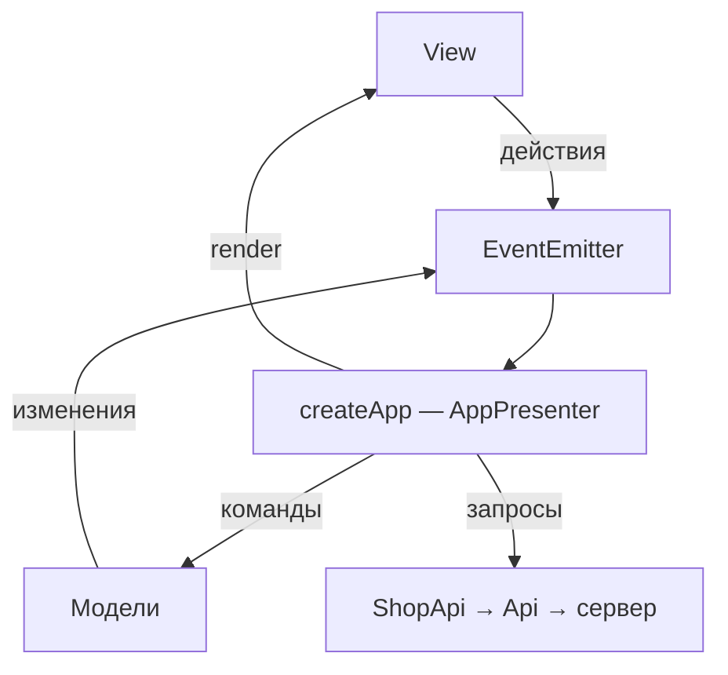

# WEB-ларёк — проект №1

Учебный интернет-магазин Яндекс Практикума, спринт 10 «Использование ООП». Пользователь просматривает товары, собирает корзину и оформляет заказ в два шага. Код разделён на данные, представления и координацию через события.

Стек: **TypeScript, HTML, SCSS, Webpack, Fetch API, ESLint**. Подробности устройства и история восстановления — в [PROJECT_ARCHITECTURE.md](PROJECT_ARCHITECTURE.md).

**Ограничение оплаты:** прикладной `card` преобразуется в серверный `online`. `cash` («При получении») отклоняется адаптером до HTTP с ошибкой `contract-unavailable`: точное серверное значение и успешный сценарий не подтверждены. Реальные заказы в проверках не создавались. Проверять отправку следует на контролируемом стенде ниже.

## 1. Окружение

Нужны Node.js и npm. Открывайте терминал в корне проекта, где лежит `package.json`.

| Среда | Что подтверждено |
| --- | --- |
| Windows пользователя | Node.js **22.15.0**, npm **10.9.2**; `npm ci`, ESLint **0 ошибок/0 предупреждений**, TypeScript включая strict, наборы 30/42/85/40/98/38/8 и production build — **PASS**. Контролируемые production-проверки выполнены локально; развёртывание на внешнем хостинге не проверялось |
| Linux исполнителя | Node.js **24.22.1**, npm **11.9.0**; статические проверки и build прошли, UI проверен в jsdom, а не в браузере |

Минимальные версии в `package.json` через `engines` не заданы. Указанная пара — проверенная Linux-среда, а не установленный минимум для всех платформ. Подготовка Linux-окружения, включая историческую проблему Babel-плагина, описана в [отчёте этапа 6](STAGE6_REPORT.md); чистый `npm ci` на Linux здесь не обещается.

## 2. Установка и запуск магазина

Команды для PowerShell:

```powershell
node --version
npm --version
npm ci
```

Если `.env` ещё нет, скопируйте пример:

```powershell
Copy-Item .env.example .env
npm start -- --port 8080
```

На Linux/macOS команда копирования — `cp .env.example .env`. Если `.env` уже существует, сохраните свою настройку и выполните команду запуска отдельно.

Откройте **http://localhost:8080/**. Это обычная страница магазина с настоящим API каталога. При занятом порте укажите другой через `--port`; остановка — **Ctrl+C**.

На обычной странице можно проверить каталог, карточку, корзину и формы. Нажатие финальной кнопки онлайн-заказа обращается к реальному серверу; для проверки отправки и успеха используйте **CONTROLLED_CHECK_URL** из раздела 9.

## 3. Переменные окружения

Пример `.env.example` содержит публичный origin:

```dotenv
API_ORIGIN=https://larek-api.nomoreparties.co
```

Из него `src/utils/constants.ts` формирует `/api/weblarek` и `/content/weblarek`. `createApp` разрешает полученные адреса; при пустом `API_ORIGIN` использует тот же публичный origin.

Webpack читает `.env`, если `NODE_ENV` не задан, и `.env.<NODE_ENV>`, если он задан. Поэтому обычный `npm start` использует `.env`, а `npm run build` задаёт `NODE_ENV=production` и читает **`.env.production`**. Для собственного production-origin создайте этот файл с нужным `API_ORIGIN`; `.env` автоматически вместо него не читается. Уже заданная переменная процесса имеет приоритет перед dotenv.

Значение подставляется при сборке. После изменения перезапустите dev-сервер или пересоберите `dist`; правка `.env` не перенастраивает готовый `main.js`.

## 4. Структура проекта

| Путь | Назначение |
| --- | --- |
| `src/index.ts`, `src/app.ts` | Вход приложения и координатор `createApp` |
| `src/models/` | Каталог, корзина и черновик заказа |
| `src/components/`, `src/components/base/` | View, общие Component/Form, существующие Api и EventEmitter |
| `src/services/`, `src/integration/` | ShopApi, проверки/преобразования DTO и загрузка каталога в модель |
| `src/types/`, `src/utils/` | Прикладные типы, отдельные сетевые DTO, DOM-утилиты и URL-константы |
| `src/pages/`, `src/scss/`, `src/common.blocks/` | HTML-шаблоны и стили; изображения/шрифты находятся в `src/images/`, `src/vendor/` |
| `scripts/`, `tests/` | Запуск проверок, контролируемые ответы и браузерные наборы |
| `docs/api/`, `docs/testing/` | API-снимки/примеры поставщика и результаты проверок с указанной средой |
| `dist/` | Результат сборки; игнорируется Git, включён в передаваемый ZIP |

`api.yml` относится к **Film/Afisha** и не используется как спецификация магазина.

## 5. Архитектура и основные классы

Роль **AppPresenter выполняет функция `createApp`**. Она создаёт зависимости, подписывается на события, командует моделями и передаёт View готовые данные. Модели не знают DOM/HTTP; View не обращаются к моделям или API. Одна общая EventEmitter связывает слои.



| Класс / функция | Ответственность и важные методы |
| --- | --- |
| `CatalogModel` | Хранит снимки товаров: `setItems`, `getById`, getter `items` |
| `BasketModel` | Уникальные покупаемые товары, количество и сумма: `add`, `remove`, `has`, `getState`, `clear` |
| `OrderModel` | Черновик и валидация: `setField`, `validate`, `createOrder`, `clear`, getter `draft` |
| `ShopApi`, `Api` | Предметные `getProducts`/`submitOrder`, проверка DTO; HTTP выполняет существующий `Api.get`/`post` |
| `EventEmitter` | `on`, `off`, `emit`, `onAll`, `offAll`, `trigger`; координатор снимает только свои callback |
| `Component`, `Form` | Базы View: `render`, `destroy`; защищённый `listen` регистрирует DOM-обработчики, Form обрабатывает input/submit и показывает готовую валидацию |
| `Page`, `Modal` | Страница: `render`, `setCatalogRetry`; окно: `render`, `open`, `close`; оба освобождают ресурсы через `destroy` |
| `CatalogCard`, `ProductPreview` | Карточка каталога и подробности товара; preview показывает описание и готовое состояние кнопки |
| `Basket`, `BasketItem` | Список/общая сумма и отдельная строка с удалением; расчёты остаются в модели |
| `OrderForm`, `ContactsForm` | Способ оплаты/адрес и email/телефон; ошибки и disabled приходят от координатора |
| `Success` | `render(IOrderResult)` показывает подтверждённую сумму и публикует закрытие |
| `createApp` | Возвращает `ready`, `reloadCatalog()` и `destroy()`; начальная загрузка запускается автоматически |

Все View обновляются через `render` и наследуют `destroy`. DOM-обработчики создаются один раз, а не при каждом render. `createApp.destroy()` снимает собственные подписки, пытается уничтожить все свои View даже при исключении и затем передаёт первую ошибку наружу; повторный вызов безопасен. Чужие подписки остаются, поздние ответы уничтоженного приложения не применяются.

## 6. События

Обработчик всех перечисленных событий — координатор `createApp`; точные payload заданы в `AppEventMap` (`src/types/index.ts`). EventEmitter сам не валидирует payload во время выполнения.

| Событие | Отправитель | Действие координатора |
| --- | --- | --- |
| `catalog:changed` | CatalogModel | Создать карточки и обновить страницу |
| `catalog:retry` | Page | Повторить загрузку каталога |
| `product:open` | CatalogCard | Найти товар по id и открыть подробности |
| `basket:open` | Page | Показать корзину |
| `basket:add` | ProductPreview | Проверить состояние и добавить товар через модель |
| `basket:remove` | BasketItem | Удалить товар через модель |
| `basket:changed` | BasketModel | Обновить счётчик, список и preview |
| `checkout:start` | Basket | Проверить корзину и открыть первый шаг |
| `order:change` | OrderForm | Обновить способ оплаты или адрес |
| `order:next` | OrderForm | После валидации открыть контакты |
| `contacts:change` | ContactsForm | Обновить email или телефон |
| `order:changed` | OrderModel | Передать полям значения и результаты валидации |
| `order:submit` | ContactsForm | Создать снимок и начать отправку |
| `modal:opened`, `modal:closed` | Modal | Обновить блокировку страницы и состояние экрана |
| `success:close` | Success | Закрыть окно успеха |

## 7. Пользовательский сценарий

1. Каталог загружается с API; клик по карточке открывает подробности.
2. Покупаемый товар добавляется в корзину. Дубли запрещены; `price=null` купить нельзя, `price=0` допустима для приложения.
3. В корзине видны позиции, количество и общая сумма; можно удалить товар. Пустая корзина не допускает оформления.
4. Первый шаг — выбор оплаты и непустой адрес; второй — непустые email и телефон. Кнопки доступны после валидации модели.
5. Во время запроса повторная отправка и редактирование заблокированы. После проверенного подтверждения очищаются корзина/черновик и показывается успех, если окно осталось открытым.

Крестик и клик по внешнему слою закрывают Modal. Закрытие не отменяет запрос; ошибка сохраняет корзину/введённые данные для ручного повтора. Незавершённый черновик сохраняется в памяти при повторном открытии формы. После перезагрузки страницы состояние не восстанавливается.

## 8. Настоящий API и ошибки

База — `https://larek-api.nomoreparties.co/api/weblarek`, CDN — `https://larek-api.nomoreparties.co/content/weblarek`.

| Операция | Контракт и статус подтверждения |
| --- | --- |
| `GET /product/` | Реальные GET подтверждены; ответ `{ total, items }`, товар содержит id/title/description/image/category/price |
| `GET /product/{id}` | Отдельный endpoint подтверждён; текущий просмотр использует загруженный CatalogModel |
| `POST /order` | В [коллекции поставщика](https://larek-api.nomoreparties.co/weblarek.postman.json) есть пример online: payment/email/phone/address/total/items и успех HTTP 200 `{ id, total }`; реальные POST для приёмки не выполнялись |

ShopApi принимает неизвестный JSON, проверяет его во время выполнения и явно формирует данные приложения. Некорректный ответ не попадает в CatalogModel. Путь изображения разрешает существующая `resolveProductImage` из `src/utils/resolveProductImage.ts`; View получает готовый URL без повторного CDN-префикса.

При отправке `card → online`; `cash` отклоняется **до HTTP**. Пустой/повреждённый ответ, HTTP- или сетевая ошибка не считаются успешной покупкой. До очистки проверяются непустой строковый id и конечная неотрицательная total, совпадающая с отправленной суммой. Каталог можно перезагрузить кнопкой повтора; автоматического повторного POST нет.

Доказательства и границы контракта: [примеры поставщика](docs/api/provider-order-examples.json), [запись API-проверки](docs/api/verification.json). Наличие поля в примере не задаёт полный список обязательных серверных полей. Внутренние типы и DTO разнесены по `src/types/index.ts` и `src/types/api.ts`.

## 9. Production и контролируемый стенд

```powershell
npm run build
node scripts/check-app.mjs --check-only
node scripts/check-app.mjs
```

Сервер печатает два адреса:

| Адрес | Что открывается |
| --- | --- |
| **APP_URL**, обычно http://127.0.0.1:8087/ | Обычный магазин: production main.js и настоящий API каталога |
| **CONTROLLED_CHECK_URL**, обычно http://127.0.0.1:8087/__controlled/ | Автоматические 8 сценариев: тот же production main.js, но HTTP API перенаправлен в локальный контролируемый сервер |

**Успех и ошибки отправки проверяйте только на CONTROLLED_CHECK_URL.** Эти тесты не создают заказы на настоящем сервере и не доказывают реальную поддержку CASH. В production main.js тестовый entry не включён.

При занятом порте: `node scripts/check-app.mjs --port=8089`. Для готового `dist` из ZIP сборку можно пропустить и сразу запустить check-app. В Git `dist` отсутствует — после клонирования нужна сборка. Не открывайте `dist/index.html` через `file://`, используйте HTTP.

## 10. Проверки

Статические и Node-проверки из корня проекта:

```powershell
npm run lint
node node_modules/typescript/bin/tsc --noEmit
node node_modules/typescript/bin/tsc --noEmit --strict --skipLibCheck
node scripts/check-models.mjs
node scripts/check-shop-api.mjs
```

Ожидаемые результаты: линтер без ошибок/предупреждений, TypeScript PASS, модели **42/42**, ShopApi **85/85**. ShopApi-набор использует контролируемые ответы. Строгая проверка запускается флагом, `tsconfig.json` не меняется.

Браузерные наборы запускаются **по одному**; откройте напечатанный UI_FIXTURE_URL, затем остановите сервер Ctrl+C перед следующим:

| Команда | Набор / ожидаемый результат |
| --- | --- |
| `node scripts/check-ui.mjs --base --serve` | EventEmitter/Utils — **30/30** |
| `node scripts/check-ui.mjs --stage6 --serve` | AppPresenter — **40/40** |
| `node scripts/check-ui.mjs --stage5 --serve` | UI этапа 5 — **98/98** |
| `node scripts/check-ui.mjs --serve` | Исходный браузерный набор этапа 4 — **38/38**, исторически подтверждён на Windows |

Общий порт стенда — 8084, изменить можно через `--port=8085`. Production-набор **8/8** запускается по разделу 9. Команды не требуют Playwright или новых npm-зависимостей. Дополнительная compile-only проверка типизированных вызовов приведена в [отчёте задачи №3](STAGE7_TASK3_REPORT.md); результаты с пометкой среды — в `docs/testing/`.

## 11. Статус и ограничения

В задаче №5 пользователь подтвердил локальную приёмку на **Windows, Node.js 22.15.0, npm 10.9.2**: npm ci, ESLint **0 ошибок/0 предупреждений**, TypeScript/strict, 30/42/85/40/98/38/8 и build — **PASS**. Контролируемые production-проверки — **8/8**; это проверка локальной production-сборки, а не развёртывание на внешнем хостинге. Исполнитель не запускал Windows самостоятельно. Linux/jsdom-результаты и старые этапные результаты хранятся отдельно и не подменяют браузерные проверки. [STAGE6_REPORT.md](STAGE6_REPORT.md) описывает исторический снимок этапа 6; старые 37 сценариев и lint-дефекты в нём не являются текущим состоянием.

Остаются ограничения: неподтверждённый CASH и полный серверный enum оплаты; неполная формальная схема заказа; отсутствие подтверждённой идемпотентности (повтор после потерянного ответа может создать дубль); данные корзины/форм хранятся только в памяти. destroy игнорирует поздние ответы, но не отменяет HTTP физически. Сборка ранее проходила с предупреждениями Sass/шрифтов; точные результаты зависят от проверяемой среды и записаны в отчётах. Отдельный чек-лист курса недоступен; соответствие неизвестным критериям не заявляется.

Подробное устройство, события и жизненный цикл — [PROJECT_ARCHITECTURE.md](PROJECT_ARCHITECTURE.md); текущая документальная сверка — [STAGE7_TASK4_REPORT.md](STAGE7_TASK4_REPORT.md). Финальную приёмку и публикацию выполняют после решения HEAD.
